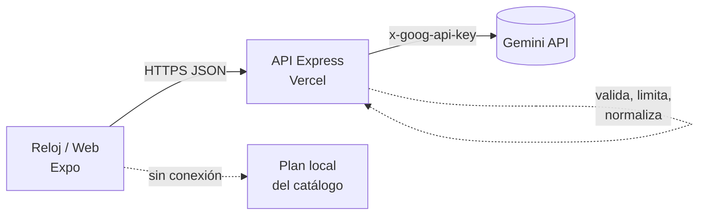

# WorkerWatch · Backend

API del proyecto **WorkerWatch**, un asistente con IA para smartwatch dirigido a trabajadores (planta industrial, logística, cocina industrial, salud…). Recibe la falla de un equipo —ya sea una alerta del sensor o lo que el trabajador dicta— y devuelve un plan de reparación breve, pensado para leerse en una pantalla redonda y decirse en voz alta.

> Este repositorio es el **backend**. La app del reloj está en [Proyectos-de-interfaces-S](https://github.com/Juanda-11/Proyectos-de-interfaces-S).

## ¿Por qué existe un backend?

La clave de Gemini **no puede ir dentro de la app** (cualquiera podría extraerla del bundle web o del APK). El reloj habla con esta API y ella habla con Gemini. Además, aquí viven la validación, el límite de peticiones, las reglas de seguridad del _prompt_ y la normalización de la respuesta.



## Endpoints

| Método | Ruta            | Descripción                                                        |
| ------ | --------------- | ------------------------------------------------------------------ |
| GET    | `/api/health`   | Estado, versión, modelo y si hay clave de Gemini configurada       |
| POST   | `/api/diagnose` | Plan paso a paso para una alerta del sensor o una descripción      |
| POST   | `/api/chat`     | Pregunta de seguimiento; si es un problema nuevo, devuelve un plan |

Especificación completa en [`openapi.yaml`](openapi.yaml). Ejemplo:

```bash
curl -X POST http://localhost:3001/api/diagnose \
  -H 'Content-Type: application/json' \
  -d '{
    "machine": { "typeId": "press", "typeLabel": "Prensa hidráulica", "name": "Prensa #02" },
    "fault":   { "title": "FUGA DE ACEITE", "metric": "Presión de aceite", "reading": "72 bar" }
  }'
```

```json
{
  "summary": "Fuga de aceite en la prensa",
  "severity": "high",
  "escalate": true,
  "steps": [
    {
      "id": 1,
      "title": "Detén la prensa y bloquéala",
      "voice": "Paso uno. Detén la prensa y aplica el bloqueo de energía."
    }
  ],
  "source": "gemini",
  "model": "gemini-flash-latest"
}
```

Los errores siempre tienen el mismo formato (`{ "error": { "code", "message", "requestId" } }`). Si la IA falla (`ai_*`), el frontend usa su plan local, así el asistente nunca se queda mudo.

## Puesta en marcha

Requisitos: Node.js ≥ 20.6.

```bash
npm install
cp .env.example .env      # completar GEMINI_API_KEY
npm run dev               # http://localhost:3001
```

La clave gratuita de Gemini se genera en <https://aistudio.google.com/apikey>.

### Variables de entorno

| Variable                 | Por defecto                              | Descripción                                                   |
| ------------------------ | ---------------------------------------- | ------------------------------------------------------------- |
| `GEMINI_API_KEY`         | —                                        | Clave de Google AI Studio (obligatoria para usar la IA)       |
| `GEMINI_MODEL`           | `gemini-flash-latest`                    | Modelo principal                                              |
| `GEMINI_FALLBACK_MODELS` | `gemini-2.5-flash,gemini-2.5-flash-lite` | Modelos de respaldo si el principal no existe o está saturado |
| `GEMINI_TIMEOUT_MS`      | `20000`                                  | Tiempo máximo por modelo                                      |
| `CORS_ORIGINS`           | `*`                                      | Orígenes permitidos; admite `https://*.vercel.app`            |
| `RATE_LIMIT_PER_MINUTE`  | `30`                                     | Peticiones por IP y minuto a `/diagnose` y `/chat`            |
| `PORT`                   | `3001`                                   | Solo en local                                                 |

> En producción `CORS_ORIGINS` debe contener la URL del frontend en lugar de `*`.

## Scripts

| Comando         | Qué hace                                              |
| --------------- | ----------------------------------------------------- |
| `npm run dev`   | Servidor con recarga automática                       |
| `npm start`     | Servidor de producción                                |
| `npm test`      | Pruebas con Vitest (la IA se simula, no gasta cuota)  |
| `npm run lint`  | ESLint                                                |
| `npm run smoke` | Llama a **Gemini real** para comprobar clave y modelo |

Para probar un despliegue publicado: `API_URL=https://<api>.vercel.app npm run smoke`.

## Despliegue en Vercel

1. Importar el repositorio en [vercel.com/new](https://vercel.com/new). El preset detectado es **Express**.
2. En **Settings → Environment Variables** definir `GEMINI_API_KEY` y `CORS_ORIGINS` (URL del frontend).
3. Desplegar y verificar `https://<api>.vercel.app/api/health`, que debe responder `"ai": "configured"`.

El preset **Express** de Vercel detecta `src/index.js`, que exporta la app (`export default app`) y la sirve como función serverless. Más detalles en [`docs/ARQUITECTURA.md`](docs/ARQUITECTURA.md).

El `Dockerfile` incluido permite desplegarlo también en otros servicios.

## Estructura

```
src/index.js            Entrada serverless (Vercel): export default app
src/
  createApp.js          Fábrica de la app Express (inyectable para pruebas)
  server.js             Arranque local
  config.js             Variables de entorno validadas con Zod
  routes/               health, diagnose, chat
  schemas/              Validación de peticiones y de la salida de la IA
  services/
    gemini.js           Cliente REST de Gemini (respaldo de modelos, timeout, JSON)
    prompts.js          Prompt de sistema con reglas de seguridad
    assistant.js        Casos de uso y normalización de los pasos
  middleware/           CORS, rate limit, errores, request id
  lib/                  Errores y logger
tests/                  Vitest + Supertest
```

## Seguridad y decisiones

- **Clave solo en el servidor**, enviada a Google por cabecera `x-goog-api-key` (no en la URL, así no queda en logs).
- **Salida estructurada**: Gemini responde con `responseSchema` y además se valida con Zod; si no cumple, el cliente recibe `ai_invalid_response`.
- **Prompt orientado a seguridad laboral**: bloqueo de energía antes de intervenir, escalar a supervisor ante riesgo de incendio/gas/presión, nunca saltarse protecciones.
- **Datos como datos**: lo que dicta el trabajador va delimitado y declarado como dato (mitiga inyección de instrucciones).
- Límite de 16 KB por petición, `helmet`, CORS por lista y límite de peticiones por IP.
- Limitación conocida: en Vercel el límite de peticiones es por instancia (mejor esfuerzo). Para un límite global haría falta un almacén compartido (p. ej. Upstash Redis).
- La IA es una ayuda, no sustituye los procedimientos oficiales de mantenimiento de cada planta.
