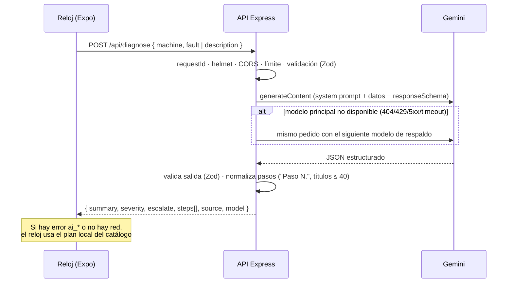

# Arquitectura del backend

## Flujo de una consulta

## Capas

| Capa         | Archivo                           | Responsabilidad                                                 |
| ------------ | --------------------------------- | --------------------------------------------------------------- |
| HTTP         | `src/createApp.js`, `middleware/` | Seguridad, CORS, límites, logs y formato uniforme de errores    |
| Rutas        | `src/routes/`                     | Validan la entrada y delegan en los casos de uso                |
| Casos de uso | `services/assistant.js`           | Construyen el prompt, validan y normalizan la salida            |
| Proveedor IA | `services/gemini.js`              | Llamada REST, modelos de respaldo, timeout, extracción del JSON |
| Dominio IA   | `services/prompts.js`             | Reglas de seguridad y estilo del asistente                      |

`createApp({ config, gemini })` recibe el cliente de Gemini por parámetro: las pruebas inyectan uno falso y la suite completa corre sin red ni cuota.

## Normalización de la respuesta

El reloj tiene una pantalla redonda y habla en voz alta, así que no se confía en el formato crudo del modelo:

- Se quita la numeración que el modelo ponga en el título (`1.`, `Paso dos:`).
- Cada frase hablada empieza con `Paso <número>.`; si falta, se agrega.
- Títulos ≤ 40 caracteres, frases habladas ≤ 240, máximo 6 pasos.
- `severity: critical` fuerza `escalate: true`.

## Manejo de errores

| Código                | HTTP | Cuándo                                     | Qué hace el reloj     |
| --------------------- | ---- | ------------------------------------------ | --------------------- |
| `invalid_request`     | 400  | El cuerpo no cumple el esquema             | Error de programación |
| `rate_limited`        | 429  | Demasiadas peticiones desde una IP         | Plan local            |
| `ai_not_configured`   | 503  | Falta `GEMINI_API_KEY`                     | Plan local            |
| `ai_rate_limited`     | 429  | Cuota gratuita de Gemini agotada           | Plan local            |
| `ai_timeout`          | 504  | Ningún modelo respondió a tiempo           | Plan local            |
| `ai_blocked`          | 422  | Filtros de seguridad de Gemini             | Plan local            |
| `ai_upstream_error`   | 502  | Error de Google (clave inválida, 4xx, 5xx) | Plan local            |
| `ai_invalid_response` | 502  | La IA no devolvió el JSON esperado         | Plan local            |

Los detalles técnicos van a los logs (con `requestId`); al cliente solo llega un mensaje genérico.

## Despliegue serverless

`src/index.js` exporta la app de Express (`export default app`) y el preset Express de Vercel la sirve como función. Cada instancia es efímera, por eso el backend es **sin estado** (no guarda sesiones: el reloj envía el contexto necesario en cada petición). Consecuencia: el límite de peticiones es por instancia y funciona como protección de mejor esfuerzo.

## Mejoras futuras

- Límite de peticiones global con un almacén compartido (Upstash Redis).
- Autenticación por dispositivo (token por reloj) en lugar de CORS abierto para el APK.
- Streaming de la respuesta para que el reloj empiece a hablar antes.
- Registro de reportes de falla (requiere base de datos).
